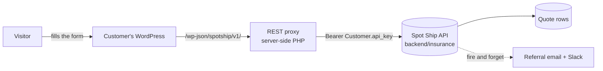

# wordpress-insurance

Spot Ship's war insurance quote forms — war hull and war cargo — as a WordPress
plugin, installed on **customers' own public websites**.

A customer drops a shortcode or a block onto a page. The plugin renders the
form, serves the indicative rate table, and relays a completed enquiry to Spot
Ship's `backend/insurance` API, where it becomes a referral on the request
thread.



**The browser never holds the credential.** Every upstream call is made
server-side by `includes/class-api-client.php`; the key is never rendered into
a page, localised into a script, or exposed on a public route. This is the
plugin's central constraint, not an implementation detail.

## How it is put together

| Path | What it does |
|---|---|
| `spotship-war-insurance.php` | Header, constants, autoloader, hooks, update checker |
| `includes/class-rest-proxy.php` | The `spotship/v1` routes. **Read its class docblock first.** |
| `includes/class-api-client.php` | `wp_remote_*` wrapper, bearer auth, 8s timeout |
| `includes/class-settings.php` | Settings, sanitisation, origin binding |
| `includes/class-rates-cache.php` | Cache tiers: live → 7-day backup → bundled → hide |
| `includes/class-renderer.php` | One markup path, shared by shortcode and block |
| `templates/`, `assets/` | Markup, vanilla-JS front end (no build step), scoped CSS |
| `tests/` | Unit, integration, jsdom, browser, real-backend — see `TESTING.md` |

Shortcode and block render through **one** renderer, so there is exactly one
markup path to keep accessible.

### The upstream contract is derived, never written

`tests/fixtures/backend-201-keys.json` and `tests/fixtures/backend-rates.json`
are **generated from the backend source** by `bin/derive-backend-keys.sh` and
`bin/derive-backend-rates.sh`. Do not hand-edit either.

Both exist because a hand-written fixture has twice become the contract the
plugin was built against: once for the 201 body, where the anti-bot decoy was
then shaped to imitate the fiction, and once for the rates body, where the whole
rate table was written against a shape the API does not emit and no suite could
see it. `TESTING.md` has the detail.

### Two invariants that are easy to break

**Decoy parity.** A client flagged as a bot gets a fabricated 200 that is
byte-identical to a real success. For that to be worth anything, a flagged
client's answer must equal what the *same payload* would have received
unflagged — for **every** refusal the plugin can decide locally. Any
locally-decidable refusal placed below the decoy gates becomes a one-request
detection oracle. This has been broken three times. A table-driven parity test
in `tests/integration/RestProxyTest.php` enforces it; add a row rather than
trusting the comment.

**Origin binding.** Customers clone production WordPress to staging, and the
clone carries the key. The plugin records the site it was bound to and refuses
to submit from anywhere else, with a one-click re-bind for the legitimate case.
`wp_get_environment_type()` is not usable for this — it reads an environment
variable clones almost never set, so it defaults to `production` and passes
silently.

## Working on it

There is **no host PHP requirement**. `Taskfile.yml` and `bin/phpcs-hook.sh`
both fall back to `docker run php:8.1-cli`, so a fresh machine needs only
Docker.

```sh
task init              # composer + npm + pre-commit hooks
task lint              # PHPCS (WPCS + PHPCompatibilityWP)
task stan              # PHPStan level 6
task test              # lint + stan + PHP unit + jsdom + mutation check
task test:unit         # PHPUnit + Brain Monkey, no WordPress
task test:integration  # PHPUnit inside wp-env
task test:js           # jsdom — no browser, no Docker
task test:mutation     # proves the tests still detect the defects they name
task test:e2e          # Playwright
task test:a11y         # axe-core, no rules disabled
```

`task test:js` drives the real, unmodified `assets/js/war-insurance.js` through
real DOM events. It has caught bugs the browser suite never executed.

`task test:mutation` reintroduces each shipped defect and fails unless the named
tests go red. It has twice found a test that detected nothing.

Conventions that will trip you up, and the rest of the reasoning, are in
[`CLAUDE.md`](CLAUDE.md). Which gate proves what, and what is still unproven,
is in [`TESTING.md`](TESTING.md).

## Releasing

Tag → build zip → GitHub Release. `bin/build-dist.sh` stages the build in a
temporary directory and never mutates the working checkout, and it checks the
finished artifact against an **allow-list** of what may ship — a blocklist
fails open, and the zip is unpacked verbatim onto a customer's server.

The bundled fallback rate table is generated at release time from the live
endpoint. The repository ships it **empty** on purpose: these are commercially
approved figures, and a hand-written placeholder would put invented numbers on
a customer's public website.

Updates are delivered by `plugin-update-checker` against this repository's
Releases feed. The repository is private, so a customer who wants in-dashboard
updates sets their **own** `SPOTSHIP_WI_GITHUB_TOKEN` in `wp-config.php`.
**Never ship a Spot Ship token in the artifact** — it would be readable by every
customer who has the zip.

## Known gaps

- **The real-backend suite has never run.** `tests/real-backend/` talks to the
  live dev deployment. Both `dev` environment secrets are now set, and the
  workflow is reachable without waiting for a merge — `workflow_dispatch` only
  works for files already on the default branch, so it also triggers on a
  `real-backend-*` tag:

  ```sh
  git tag real-backend-$(date +%Y%m%d-%H%M) && git push origin --tags
  ```

  **A tag run is read-only.** It exercises real autocomplete, real rate data,
  axe on the real rate table, a real 401 from real authentication, a real DNS
  failure, the origin-binding refusal and the no-JavaScript case — creating no
  records and sending nothing.

  ⚠️ **`vessel_search` is answering HTTP 500 on dev.** `rates/` and
  `location_search` are healthy — the latter returns real Rotterdam hits — so
  this is one index, not the deployment. An earlier run had all three failing
  and that had cleared twenty minutes later, so treat any single reading as a
  snapshot. This is a backend problem and not fixable here; the workflow fails
  at its probe step and names the endpoint. Until it is resolved the vessel
  autocomplete cannot be verified against real data.

  The two tests that submit a valid payload are tagged `@writes` and excluded
  unless a run asks for them, because the backend fires a referral **email and
  Slack post** for every row it stores. `notifications.py` posts to
  `INSURANCE_REFERRAL_WEBHOOK_URL`, which its own docblock says is the same
  Workflow Builder workflow the serica referral views use — so a test enquiry
  can land in front of whoever reads that channel looking exactly like a real
  one, and cannot be un-sent.

  ```sh
  gh workflow run real-backend-e2e.yaml -f reason="…" -f writes=true
  ```

  Confirm where dev's `INSURANCE_REFERRAL_WEBHOOK_URL` and
  `INSURANCE_REFERRAL_EMAIL_RECEIVER` point first, and have somebody watching
  them — that run is also the only way to confirm referral delivery at all,
  since both are dispatched fire-and-forget with no flag to query afterwards.

  Until it runs with `writes=true`, persistence, attribution and consent
  provenance are verified only against a stand-in upstream. Treat those specs
  as unverified code.
- **Referral email and Slack delivery are not covered by any automated run.**
  `backend/insurance/notifications.py` dispatches both fire-and-forget and
  records no flag, so nothing in the API can be asked afterwards. Confirming
  them means watching the dev mailbox and the Slack channel during a
  `writes=true` run — see above.
- **ENG-6383** — the rate values have never been confirmed against the
  commercial Google Sheet.
